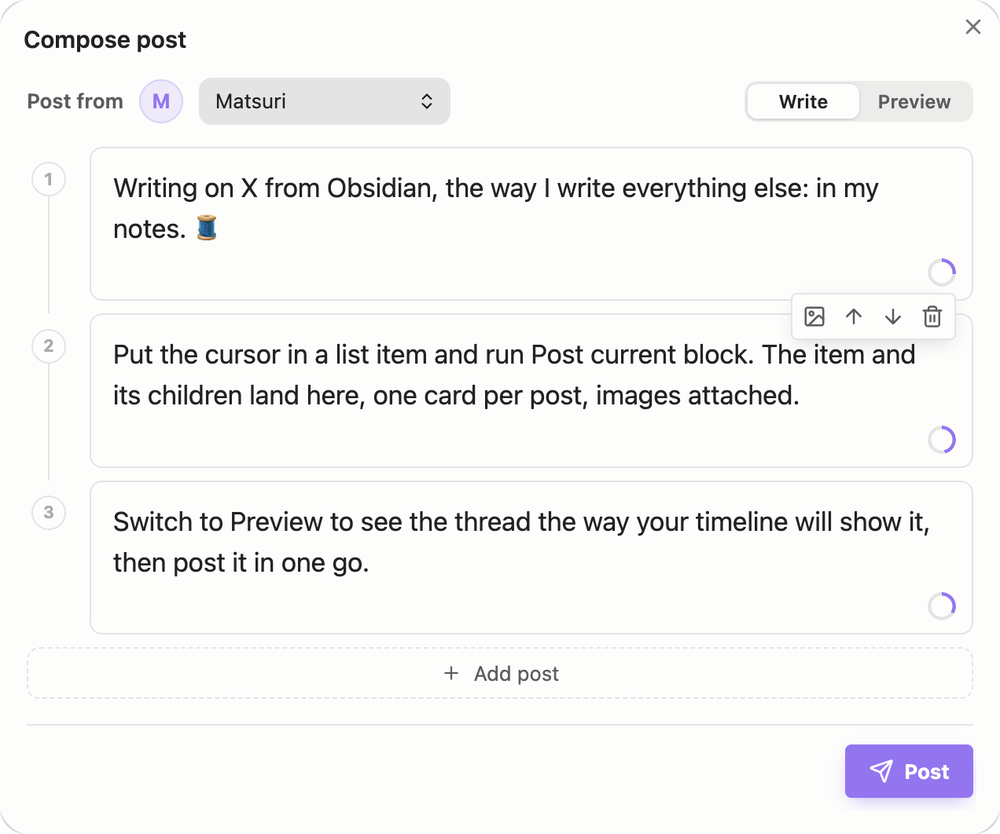
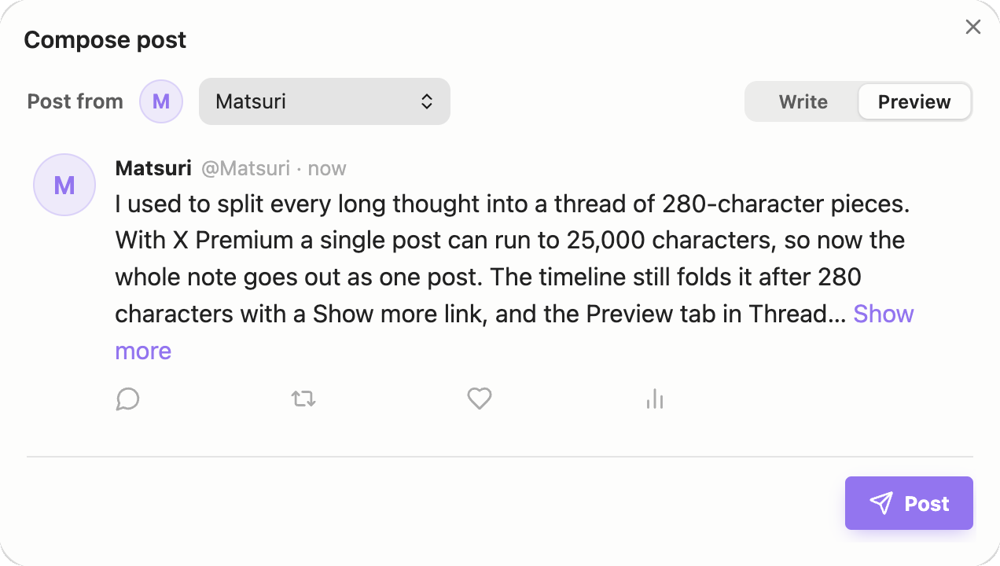

# Thread Studio

在 Obsidian 笔记里写 X 的帖子、帖串、长帖和文章，撰写框里先看到时间线上会是什么样。

[English](README.md)

  
  

Thread Studio 改自 Christian Bager Bach Houmann 的 [NoteTweet](https://github.com/chhoumann/notetweet_obsidian)，经原作者同意发布（[chhoumann/notetweet_obsidian#76](https://github.com/chhoumann/notetweet_obsidian/issues/76)）。NoteTweet 原有的功能都在，另外加了：

- **Write / Preview 两档**：Preview 照 X 的样子排出整串帖子：头像、名字、帖串连线、多图排版，链接、话题、@ 提及上色。
- **发光标所在的块**：光标放在列表项或段落里，用命令、左侧栏的纸飞机或右键菜单，这一项连同子项带进撰写框，里面嵌的图片自动挂上；任务关键词（`TODO`、`DOING`…）、双链括号、加粗等记号、`%%注释%%` 会去掉。发出去以后在这一块的第一行打上发帖标签。
- **X 会员长帖**：打开「X Premium long posts」，一条帖子最多 25,000 字，不再拆成帖串。超过 280 字后计数显示总字数，Preview 在 X 折叠的位置显示「Show more」。
- **X 文章（Articles）**：「Post note as X Article」把当前笔记发成 X 文章，标题、列表、引用、粗体、斜体、删除线、链接、图片、代码块、表格、分割线都带过去。可以直接发布，也可以先存成草稿，到 X 的编辑器里改完再发。
- **有动效的撰写框**：像 X 那样转满的字数环，加帖、挪动、拆分、删除时卡片滑到新位置，指到按钮上图标会动一下，还有轻短的界面音（可关）。系统开了「减少动态效果」就不放动画。

## 安装

在 Obsidian 社区插件市场上架之前：

- **用 BRAT**：装 [BRAT](https://github.com/TfTHacker/obsidian42-brat)，运行「BRAT: Add a beta plugin for testing」，填 `MatsuriMW/thread-studio`。
- **手动**：从[最新 Release](https://github.com/MatsuriMW/thread-studio/releases/latest) 下载 `main.js`、`manifest.json`、`styles.css`，放进 `<你的库>/.obsidian/plugins/thread-studio/`，再到「设置 → 第三方插件」里启用。

需要 Obsidian 1.13.0 以上（凭据存在 Obsidian 的加密 Secret Storage 里）。可以和 NoteTweet 同时装，两边的设置和凭据互不相干。

## 设置

发帖走你自己的 X 开发者应用，需要从 X Developer Portal 拿四个值：

1. 登录 [developer.x.com](https://developer.x.com)，在 [Developer Portal](https://developer.x.com/en/portal/dashboard) 新建一个 App（新建的会自动放进 Project，X API v2 要求这样）。
2. 记下创建时显示的 **API Key**（Consumer Key）和 **API Key Secret**（Consumer Secret）。
3. 让应用能发帖：在 App 的 **Settings → User authentication settings → Edit** 里打开 **OAuth 1.0a**，权限选 **Read and write**；回调地址和网站地址都填 `https://github.com/MatsuriMW/thread-studio`，类型选 **Web App, Automated App or Bot**，保存。然后在 **Keys and tokens → Access Token and Secret** 点 **Generate**，得到 **Access Token** 和 **Access Token Secret**。之后改了权限要重新生成，否则令牌还是只读的。
4. 在 Thread Studio 设置里点 **Add account**，起个名字，把四个值填进去，点 **Test** 测连接。要用几个账号就加几个。

## 用法

- **撰写框**：命令「Post tweet」。选中的文字会带进来：`THREAD START` / `THREAD END` 块直接按帖子分好，其他文字超过字数上限自动拆开，粘贴长文也会拆。快捷键：`Alt + Enter`、到上限时按 `Enter` 或连按三次回车开新帖；`Shift + Enter` / `Ctrl + Enter` 在上 / 下插一条；`Ctrl + ↑↓` 切换帖子；`Ctrl + Shift + ↑↓` 挪动；空帖里按 `Backspace` 或 `Ctrl + Shift + Delete` 删除。图片可以从库里挑、直接粘贴，或写图片的 `[[双链]]`，每条最多四张。
- **发光标所在的块**：命令、左侧栏或右键「Post current block」。列表里取光标所在的那一项和它所有子项，不在列表里取所在段落；子项保留 `-` / `1.` 记号。
- **X 会员长帖**：设置里打开「X Premium long posts」。没有会员时 X 会拒绝超过 280 字的帖子，提示里会显示 X 给的原因。
- **X 文章**：打开笔记，运行「Post note as X Article」，确认标题和账号后选 **Publish**（发布）或 **Save draft**（存草稿，提示里的链接直接打开这份草稿）。标题依次取笔记的 `title` 属性、第一行的 `# 标题`（取了就不再放进正文）、文件名；封面取 `cover` 属性里的图片（如 `cover: "[[header.png]]"`）。`#` / `##` / `###` 及以下对应 X 的三级标题；`==高亮==` 变粗体；双链变成纯文字；库里的图片会上传；代码块和表格按 Markdown 块放进去；嵌套列表会摊平（X 文章没有列表层级）。需要发帖账号有 X 会员。
- **快速发帖**：「Post selection as tweet」直接把选中文字用默认账号发出去；「Post file as thread」发当前笔记里第一个 `THREAD START` / `THREAD END` 块（帖子之间用单独一行 `---` 隔开）。发完的弹窗能打开每条帖子，也能一键删除；设了 **Tweet tag** 会把标签写回笔记。
- **定时发帖**（可选）：通过自建的调度服务定时发，见[调度服务说明](GuideToSettingUpScheduler.md)（英文）。

## 联网与账号

- 只在发帖、定时、上传图片、删除刚发的帖子、测试账号时连接 X API（`https://api.x.com`），发送的是你要发的文字和图片。没有统计或遥测。
- 需要你自己的 X 开发者应用和四个密钥；X 可能按你的开发者套餐对 API 调用收费。长帖和文章需要 X 会员。
- 开了定时发帖的话，帖子和调度密码会发到你填的调度服务地址。
- 凭据存在 Obsidian 的加密 Secret Storage 里，不写进插件的 `data.json`。插件会读取库里的图片用于上传，把发帖标签写回笔记，不碰库外的文件。

## 反馈与后续

想追踪后续功能、反馈问题、关注后续进展，欢迎关注我的 Twitter：[@Matsurimywaifu](https://x.com/Matsurimywaifu)。

## 致谢

Thread Studio 建立在 [Christian Bager Bach Houmann](https://bagerbach.com/) 的 [NoteTweet](https://github.com/chhoumann/notetweet_obsidian) 之上：撰写框、X API 客户端、Secret Storage 和定时发帖都是他写的，也感谢他同意这个分支。图标是 [Lucide](https://lucide.dev)（ISC 许可），动效参考 [lucide-animated](https://github.com/pqoqubbw/icons)；Preview 参考 X 自己的撰写框和 [Typefully](https://typefully.com) 的预览栏。

## 许可

[MIT](LICENSE)，保留 NoteTweet 原有的版权声明。
